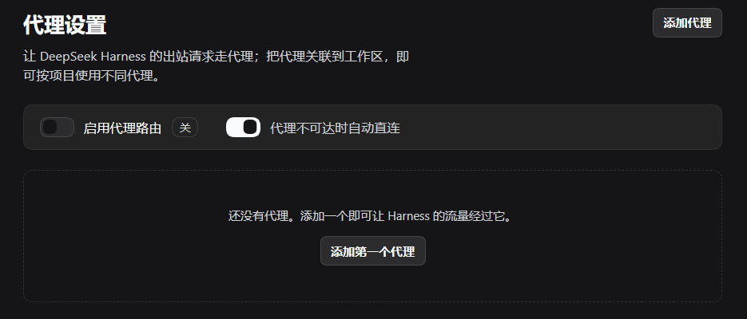
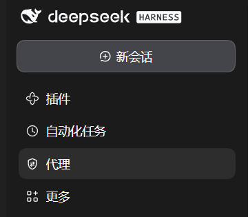
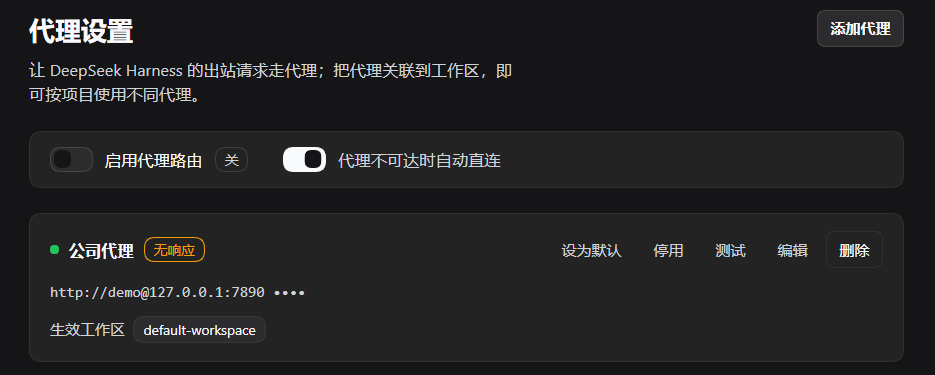

# dsh-workspace-proxy

> 给 [DeepSeek Harness](https://github.com/deepseek-ai/deepseek-harness) 的每个工作区,配一条自己的出站代理。

一个客户仓库要走公司代理、另一个仓库要直连;全局 `HTTPS_PROXY` 只能二选一。这个插件把出站代理
做成**按工作区生效**的资源:每个代理单独勾选它作用于哪些工作区,模型请求、联网搜索、HTTP MCP 会
按当前会话所在的工作目录自动分流。



## 为什么需要它

- 一个 Harness 里同时开着内网项目和外网项目,两个项目需要不同的出口;
- 公司代理需要账号密码,但不想让所有流量都走它;
- 换代理客户端(端口变了)时,不想重新启动整个 Harness;
- 代理挂了的时候,不想整个助手直接变成「DeepSeek Messages transport failed」。

## 特色功能

| 特色 | 说明 |
|---|---|
| **按工作区生效** | 每个代理单独勾选生效工作区。会话按工作目录匹配,嵌套工作区取**最长路径优先**,monorepo 子目录也能精确命中。 |
| **默认代理兜底** | 没命中任何工作区绑定时,使用标记为「默认」的那个代理。 |
| **独立账号密码** | 每个代理可单独填用户名/密码;面板里密码只显示为 `••••`,不会回显。 |
| **NO_PROXY 直连列表** | 每个代理可单独设置直连主机(`.internal`、`git.company.com:443` 等),支持 `*`。 |
| **健康检查** | 启动时和每次保存后,对每个启用的代理做一次真实 `CONNECT` 握手探测;失败的在卡片上标「无响应」。`407` 视为可达(只是要凭据)。 |
| **不可达自动直连** | 默认开启:探测失败的代理会被跳过、该请求直连,不会因为一个坏代理让整个 Harness 无法对话。可以关掉,改成 fail-closed。 |
| **回环永远直连** | `localhost` / `127.0.0.0/8` / `::1` 永不经过代理,Web UI、本地面板 API、本地 MCP 服务不会被绕进去。 |
| **保存即生效** | 改完立刻对下一个请求生效,不需要重启 Harness,也不需要重载插件。 |
| **左侧栏图形面板** | 左栏「代理」入口:添加、编辑、启停、测试、设为默认、勾选工作区,全部可视化。 |
| **零依赖** | 复用 DSH 自带的 `undici`,不新增任何 npm 依赖、不加构建步骤。 |

左栏入口:





## 安装

插件是一个 DSH bundle:`dsh.bundle.patch` 插入 Host 行,`dsh.client` 提供浏览器端。

```bash
# 从 GitHub 安装(git 依赖)
dsh plugin --profile <profile> add github:NingbingHG/dsh-workspace-proxy

# 从本地目录安装(开发时)
dsh plugin --profile <profile> add link:/absolute/path/to/dsh-workspace-proxy
```

也可以在 Web 界面的插件管理器里安装这个包。安装后左栏出现「代理」入口,设置保存在
`$DSH_HOME/proxy-settings.json`。

## 三步用起来

1. 左栏点「代理」→「添加代理」,填地址(如 `http://127.0.0.1:7890`),需要认证就填用户名密码;
2. 在「生效工作区」里勾选它作用于哪些工作区;想让它兜底就再打开「作为默认代理」;
3. 保存。点卡片上的「测试」可以看到这次测试实际命中的路由、HTTP 状态码和耗时。

## 工作方式

插件接管 Node 内置 `fetch` 所用的 undici 全局 dispatcher,每次请求按下面的顺序决策:

1. 全局开关关闭 → 直连;
2. 目标是回环地址 → 直连;
3. `ctx.agents.currentInitiator()` 找到发起这次请求的会话,取其工作目录;
4. 用最长路径匹配工作区,取该工作区绑定的代理;
5. 没命中绑定 → 用「默认代理」;两者都没有 → 直连;
6. 命中代理的 `NO_PROXY` 列表 → 直连;
7. 已知代理不可达且「自动直连」开着 → 直连;否则经该代理转发。

绑定关系是**路径包含**匹配:会话的工作目录在某个已绑定工作区路径之下即命中,嵌套时取最长的那个。

## 健康检查与兜底

一个能连上但转发不了任何东西的代理,会把每个模型请求变成一句 `DeepSeek Messages transport failed`。
两条措施避免这种情况把 Harness 锁死:

- 插件启动时、以及每次保存设置后,对每个启用的代理向 `api.deepseek.com:443` 做一次真实
  `CONNECT` 探测;连不上、解析不了或者不响应的,卡片上标「无响应」;
- 「代理不可达时自动直连」默认开启:这类代理会被跳过、请求直连。关掉这个开关即恢复 fail-closed
  行为(代理不可用就失败)。

只要对端回了状态行就算「可达」,哪怕回的是 `407` —— 那说明代理要凭据,而不是挂了。

## 存储与本地 API

设置保存在 `$DSH_HOME/proxy-settings.json`,由插件自己的本地路由 `/proxy-settings/api` 读写;
保存后对下一个请求立即生效。删掉这个文件即回到「没有配置任何代理」。

- `GET  /proxy-settings/api` —— 当前设置、工作区列表、引擎状态、各代理健康状态;
- `POST /proxy-settings/api` —— 保存设置(JSON),校验失败返回 400 和具体原因;
- `GET  /proxy-settings/test?url=…&proxyId=…` —— 用**同一套路由代码**发一次请求,返回命中路由、
  状态码与耗时;面板的「测试」按钮调用它。

## 安全说明

装这个插件等于把**整个进程的出站出口**交给它,所以它该说清楚自己碰了什么、怎么防的:

**它能做什么(信任前提)**

- 替换进程级 undici dispatcher —— 模型接口、联网搜索、HTTP MCP 的请求都会经过它。这是功能本身,
  也是安装它的信任成本;不信任时可以随时停用或卸载,dispatcher 会还原成原来的那个。
- 没有安装脚本(`preinstall` / `postinstall`),没有运行时 npm 依赖,发布内容就是仓库里这些文件。

**本地设置 API 的防护**

- 只监听回环地址,并校验 `Host` 必须是本机 GUI 的来源(其余返回 403):这是防 DNS rebinding ——
  否则恶意网页可以把自己的域名解析到 127.0.0.1 再读走你的代理配置。
- 校验 `Sec-Fetch-Site` 与 `Origin`:跨站请求(包括 `no-cors` 的「简单请求」)一律拒绝;写操作还要求
  `Content-Type: application/json`,让跨站写必须先过预检,而本路由不应答预检。
- 结论:网页读不到、也改不了这个 API;但**本机上的其他进程可以**(它们本来也能直接读那个 JSON 文件),
  这是本机可信模型的边界,不是网页边界。

**密码怎么处理**

- API 永远不回传密码,只回 `hasPassword`;编辑时留空表示「保持原密码」,勾选「清除已保存的密码」才会删除。
- 密码以明文保存在 `$DSH_HOME/proxy-settings.json`,靠操作系统账户权限保护;共用电脑请谨慎保存凭据。

**`/test` 的 SSRF 边界**

- 只接受 `http://` / `https://`,并拒绝本机、`.local` / `.internal`、RFC 1918、链路本地等目标,避免把
  Harness 变成访问本机或内网的跳板。
- 残余风险:域名解析到内网地址的情况没有二次校验(需要放开 DNS 解析,代价大于收益),所以别把
  这个 API 暴露到回环之外。

## 已知限制

- 只管**进程内**流量:模型接口、联网搜索、HTTP MCP。shell 工具里跑的 `curl` / `git` / `pnpm` 继承的是
  进程环境变量,不受这里影响 —— 需要的话给它们单独设 `HTTPS_PROXY`(DSH 自己的 `dsh-http-proxy`
  也认这个变量,作用于整个进程)。
- 只支持 `http://` 和 `https://` 代理;SOCKS / PAC 会被编辑器拒绝。
- 需要 TLS 中间人证书的公司代理,要在启动前设 `NODE_EXTRA_CA_CERTS`,本插件既不设置也不校验它。

## 目录结构

| 路径 | 内容 |
|---|---|
| `index.js` | Host 端:设置存储、路由 dispatcher、`/proxy-settings` HTTP API |
| `client.js` | 浏览器端:左栏入口、主面板、编辑器 |
| `cordis.patch.yml` | 插入 Host 行的 bundle patch |
| `locale/*.json` | 插件管理器里显示的名称与描述(`en` / `zh`) |
| `icon.svg` | 侧栏与插件管理器图标 |
| `docs/*.png` | 本文档用的截图(已裁掉侧栏会话列表与本机路径) |

## 开发

两个半边都是纯 ESM / 浏览器 JavaScript,没有构建步骤:

```bash
node --check index.js
node --check client.js
```

`package.json` 的 `files` 就是发布包的确切文件集合。

## English

A per-workspace outbound proxy manager for DeepSeek Harness. Every proxy can be bound to specific
workspaces, and each model / web-search / HTTP-MCP request is routed by the working directory of the
Session that initiated it. A health probe marks dead proxies, and an opt-out direct fallback keeps a
broken proxy from bricking the assistant. Loopback always stays direct; settings apply live without a
restart.

## License

MIT — see [LICENSE](LICENSE).
